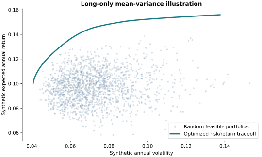
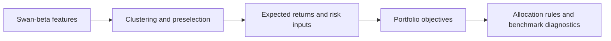

# MVO Research Lab

**Connecting equity preselection, allocation objectives and benchmark diagnostics.**

A portfolio-research notebook with clustering-based selection, mean-variance
allocation, downside-related objectives and post-allocation comparisons. A small
standalone synthetic example makes the public package explorable without the
original research workbooks.





## Quick start: public demo

```bash
pip install -r requirements-demo.txt
python examples/synthetic_portfolio.py
```

The demo solves long-only, fully invested mean-variance problems on generated
returns and plots an efficient frontier against random feasible portfolios.
It is an illustration added for reproducibility, not a reconstruction of the
Swan-beta strategy or a historical backtest.

## Research notebook

Install `requirements.txt`, supply the inputs listed in
[DATA_REQUIREMENTS.md](DATA_REQUIREMENTS.md), and open
`notebooks/mvo4_research.ipynb` from a Jupyter server launched at the repository
root. Input-dependent historical results are deliberately not advertised.

## Scope

This repository documents portfolio research. Assumptions about estimation,
look-ahead control, changing constituents, market-data revisions and transaction
costs matter before interpreting performance. No Sharpe ratio, return, production
readiness or live strategy performance is asserted here.

The project builds on an existing collaborative MVO research workflow; the
packaging does not claim sole invention of its underlying methods. See
[PROVENANCE.md](PROVENANCE.md) and [VALIDATION.md](VALIDATION.md).
